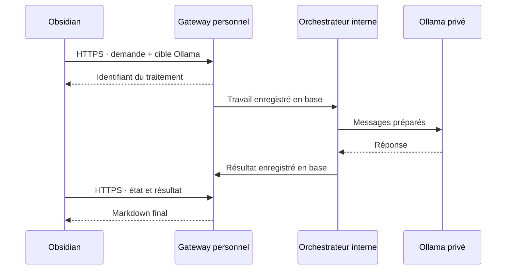
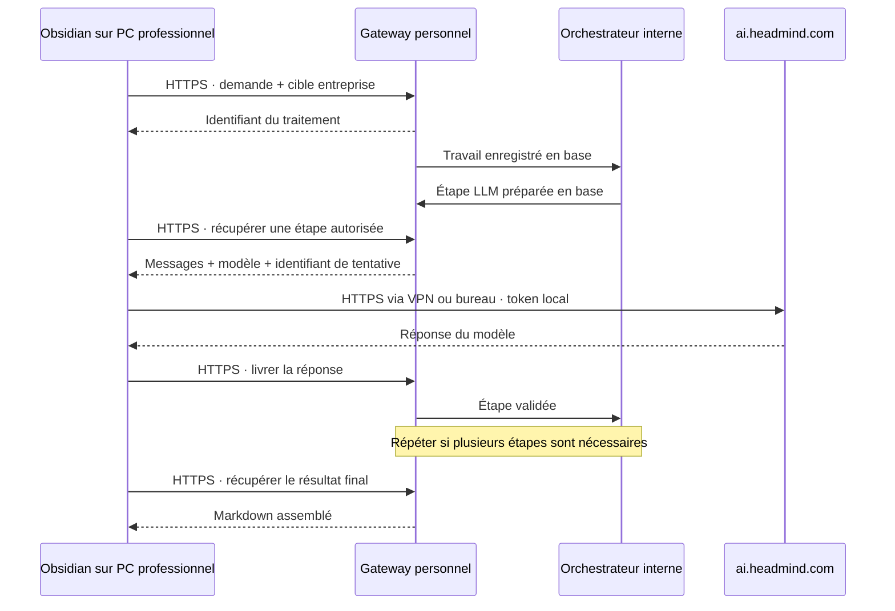

# Intégration du LLM d’entreprise dans Note Compagnon

Statut : conception approuvée. Les sections ci-dessous décrivent la cible ; les modalités de la première livraison sont précisées dans [le guide d'exploitation](enterprise-llm-relay-operations.md).
La première livraison rend persistantes les générations entreprise et conserve les routes personnelles synchrones existantes. Les étapes entreprise avancent dans les transactions du gateway ; un service interne assure seulement expiration et purge.
Date : 10 octobre 2026. Base examinée : `main`, commit `829e5bc`.

## 1. Objectif et décisions proposées

Permettre à l’utilisateur de choisir explicitement le fournisseur et le modèle pour chaque génération de texte, tout en conservant la préparation des traitements sur le serveur personnel.

- **Personnel — Ollama** : fonctionnement actuel sur l’infrastructure personnelle.
- **Entreprise — HeadMind** : orchestration personnelle, appel au LLM depuis Obsidian sur le PC professionnel, via le réseau de l’entreprise ou son VPN.
- Le choix est visible avant l’envoi et figé pour tout le traitement, y compris ses étapes intermédiaires. Aucun remplacement automatique par l’autre fournisseur.
- Le token HeadMind reste sur le PC professionnel. Le gateway ne le reçoit jamais.
- Le relais est actif uniquement pour les traitements explicitement lancés ou repris par cet utilisateur sur cet appareil.
- Transcription Whisper, diarisation, indexation, recherche et embeddings restent sur l’infrastructure personnelle. Aucun service audio Open WebUI n’est prévu.
- Première version entreprise sur Obsidian Desktop. Le fonctionnement personnel sur les autres appareils est conservé.

L’intégration livrera des réponses complètes dans un premier temps. L’affichage progressif des mots pourra venir ensuite ; un éventuel flux SSE imposé par l’instance devra néanmoins être correctement consommé par le connecteur.

## 2. État existant vérifié

Les points d’entrée utiles sont déjà présents :

- `apps/ai-gateway/app/services/llm_client.py` centralise les appels de résumé, assistant, réunion, prédigestion et réponse RAG. Ses résultats et erreurs restent liés à Ollama.
- `apps/ai-gateway/app/main.py` choisit un fournisseur global. Les générations texte restent dans la requête HTTP jusqu’au résultat.
- `run_meeting_generation` accumule actuellement en mémoire les briefs chronologiques ou les sections du mode `deep_think`.
- Les jobs persistants actuels sont spécialisés dans l’audio ; leur résultat public est une transcription. Ils ne doivent pas changer silencieusement de contrat.
- Le plugin possède déjà le choix du modèle, les modes de contexte Simple / Note / Vault, les modèles Markdown et un centre de tâches audio.
- Les settings du plugin sont enregistrés dans le vault : ce mécanisme ne convient pas au nouveau secret entreprise.
- Le déploiement repose sur Docker Compose, PostgreSQL, Redis et Nginx Proxy Manager. Portainer permet de voir la stack ; les fichiers Compose sont administrés sur le serveur.

**Conséquence : le travail principal est de rendre les générations texte persistantes et reprenables.** Un simple proxy HTTP, ou une coroutine qui attend le PC, ne résoudrait pas les pertes de connexion et les redémarrages.

## 3. Architecture et sens des connexions

### Mode personnel

Ce schéma représente la cible avec jobs persistants. Les anciens endpoints synchrones restent disponibles pour les anciennes versions du plugin.

Dans ces schémas, les échanges entre gateway et orchestrateur représentent leur coordination par la base de données et les notifications internes ; ils ne supposent pas une nouvelle API publique entre ces composants.

### Mode entreprise

Les connexions vers le gateway et vers HeadMind sont toutes initiées par le PC. Le gateway répond à une connexion ouverte par le plugin ; il ne se connecte jamais directement au PC. Aucun tunnel entrant, port local exposé ou accès VPN du serveur personnel n’est nécessaire.

Le PC professionnel doit pouvoir joindre **les deux services simultanément**. Un VPN qui autorise HeadMind mais bloque le gateway personnel serait une limite réelle à valider dès le premier lot.

### Transport proposé

Un long polling HTTPS de 25 secondes permet au plugin de réclamer une étape sans boucle rapide. La requête se termine dès qu’un travail arrive. Elle est renouvelée seulement pendant une session active, avec temporisation en cas d’erreur. Un seul consommateur existe par session du plugin, même si plusieurs vues sont ouvertes.

Le WebSocket n’est pas nécessaire à la première version : le volume d’échanges est faible et la reprise repose de toute façon sur PostgreSQL. Il pourra être ajouté comme transport ultérieur sans modifier le modèle de traitement.

## 4. Parcours utilisateur

### Choix visible et indépendant du contexte

Afficher deux sélecteurs près de l’action de génération :

- **Exécution** : Personnel / Entreprise.
- **Modèle** : liste filtrée pour le mode choisi.

Les choix Simple / Note / Vault continuent de déterminer le contexte fourni au modèle. Les choix Standard / Approfondi continuent de déterminer la méthode de génération des comptes rendus. Ces réglages ne doivent pas être mélangés au fournisseur.

Le tableau de bord et les dialogues de génération rappellent le choix courant : par exemple « Entreprise · [nom réel du modèle] · connecté ». L’action d’envoi constitue la confirmation du mode affiché ; aucune confirmation supplémentaire répétitive n’est nécessaire.

Sur un nouvel appareil, le mode personnel est la valeur initiale. Un choix entreprise synchronisé depuis un autre appareil ne suffit jamais à activer un relais. Changer de mode ne modifie pas les travaux déjà lancés ; « Relancer avec l’autre mode » crée un nouveau traitement clairement identifié.

### Connexion à HeadMind

Dans les réglages, proposer : saisir/remplacer le token, tester la connexion, consulter les modèles accessibles, activer/désactiver le relais de cet appareil.

La première version conserve le token uniquement en mémoire. Fermer Obsidian impose de le saisir de nouveau. Une persistance via le coffre du système pourra être ajoutée après vérification de sa disponibilité dans Obsidian Desktop ; elle ne doit pas être simulée par un secret encodé ou chiffré avec une clé stockée à côté.

La configuration locale non secrète identifie le profil HeadMind et l’appareil. Elle ne confère aucun droit à elle seule. Après redémarrage et authentification, l’utilisateur reprend explicitement les travaux en attente avec une nouvelle session autorisée.

### Fonctionnalités couvertes

- Assistant Simple et Note : préparation serveur, génération avec la cible choisie.
- Résumés et actions de rédaction existantes : même sélection du fournisseur.
- Comptes rendus standard : toutes les prédigestions et la synthèse finale utilisent la même cible.
- Comptes rendus approfondis : chaque section utilise la même cible ; assemblage et contrôles restent sur le serveur.
- Questions sur le vault : recherche et embeddings personnels, seuls les extraits retenus et la question partent vers le LLM choisi.
- Réunion audio : transcription et diarisation personnelles, puis génération de texte selon le mode choisi. La transcription peut finir avec Obsidian fermé ; la génération entreprise attend le retour du relais.

Pour le RAG, le mode entreprise dépend donc encore des services personnels d’embeddings et de recherche. Il ne rend pas toute l’infrastructure Ollama facultative.

### Progression et erreurs

Afficher l’étape actuelle et la raison d’une attente : préparation, attente du PC, génération, token à renouveler, accès refusé, connexion indisponible, limite temporaire, terminé, annulé ou expiré.

Ne pas diagnostiquer « VPN déconnecté » à partir de n’importe quelle erreur réseau. Distinguer les faits connus des causes possibles. Une expiration de token met le traitement en attente ; elle ne déclenche ni changement de modèle ni boucle de tentatives.

## 5. Backend : traitements persistants

### Modèle de données proposé

Ajouter une migration additive avec trois ensembles :

1. **GenerationRun** : utilisateur, vault/workspace, opération métier, fournisseur, modèle demandé, profil, appareil/session autorisé, clé d’idempotence, paramètres figés, état, progression, résultat, dates et expiration.
2. **GenerationStep** : ordre et dépendances, entrée préparée, version de préparation, résultat intermédiaire, tentative active, état, échéances et erreur normalisée.
3. **RelaySession** : utilisateur, appareil, profil autorisé, capacités/version du protocole, présence, expiration et hash du secret de session.

Les étapes conservent les informations nécessaires à une reprise identique : extraits RAG et références, template, langue, plan de découpage de réunion. Une modification de note, de modèle par défaut ou d’index ne doit pas changer un traitement déjà lancé.

Le modèle demandé et le modèle annoncé dans la réponse sont tracés séparément si Open WebUI expose les deux. Un alias de modèle n’est pas une garantie d’immuabilité des poids servis par l’entreprise.

### Orchestrateur

Ajouter un service interne `generation-orchestrator`, à partir de l’image Python du gateway, avec une commande dédiée et sans port publié. Il avance les traitements par petites transitions persistantes. Aucune transaction SQL ni aucun verrou de base n’est conservé pendant un appel réseau.

PostgreSQL fait foi. Redis sert à accélérer le réveil ; une réconciliation périodique retrouve les travaux après perte d’une notification ou redémarrage. Ne pas placer ces nouveaux travaux dans la file du worker Whisper.

Pour Ollama, l’orchestrateur exécute l’appel privé. Pour HeadMind, il prépare une étape à réclamer par le plugin. Il ne bloque jamais le sémaphore Ollama en attendant un PC.

L’introduction de ce service doit préserver les limites globales d’Ollama : le sémaphore Python actuel ne couvre qu’un processus. Les anciennes routes synchrones et le nouvel orchestrateur devront utiliser une limitation commune couvrant les générations et les embeddings, en conservant le passage par le coordinateur GPU existant. Le pilote technique vérifiera sa couverture réelle ; toute limite applicative supplémentaire devra être partagée entre processus, afin de ne pas doubler accidentellement la concurrence GPU.

### Contrat API additif

Conserver `/v1/models`, les endpoints métier actuels et les résultats des jobs audio. Ajouter :

- `GET /v1/llm/capabilities` : fournisseurs autorisés, modèles, capacités et version du protocole.
- `POST /v1/generations` : opération typée, entrée métier existante, cible explicite et clé d’idempotence ; réponse `202` avec identifiant.
- `GET /v1/generations/{id}` et `/result` : progression puis résultat.
- `POST /v1/generations/{id}/cancel` et `/resume` : arrêt ou reprise contrôlée.
- `POST /v1/relay/sessions` : création d’une session de relais.
- `POST /v1/relay/sessions/{id}/claim` : attribution atomique d’une étape avec attente longue bornée.
- `POST /v1/relay/sessions/{id}/heartbeat` : présence et état de connexion normalisé.
- `POST /v1/relay/steps/{id}/heartbeat`, `/result` et `/error` : suivi et livraison d’une tentative attribuée.

Une cible entreprise contient `provider=enterprise_relay`, `model_id`, `profile_id` et l’identifiant du relais autorisé. Elle ne contient jamais le token entreprise.

Tous ces endpoints exigent l’authentification gateway. Les routes du relais exigent en plus la preuve de possession de la session attribuée. La création d’un traitement vérifie le scope métier correspondant : `meetings:generate`, par exemple, ne peut pas être contourné par un endpoint générique de génération. Les contrôles de propriétaire restent nécessaires pour les transcriptions sources et les documents RAG.

Le nouveau plugin détecte aussi un ancien backend où ces routes n’existent pas : il utilise les anciennes routes pour le mode Personnel explicitement sélectionné et indique que le mode Entreprise nécessite une mise à jour. Cette négociation de version ne change jamais le fournisseur choisi.

### Refactorisation ciblée

Faire évoluer `llm_client.py` vers des résultats et erreurs neutres ; remplacer la sélection globale par une résolution explicite du fournisseur et du modèle. Conserver les validateurs métier, templates et préparateurs de prompts.

Créer des modules séparés pour le registre des fournisseurs, les générations persistantes, le protocole de relais et l’orchestrateur. Extraire progressivement les routes concernées de `main.py`, sans réécrire tout le gateway.

Dans le plugin, créer des modules dédiés pour les profils LLM, le client HeadMind, la boucle de relais, le suivi des générations et la gestion des secrets en mémoire. Éviter d’ajouter toute cette logique au fichier `main.ts` existant.

## 6. Connecteur Open WebUI et limites

La documentation officielle décrit `GET /api/models` et `POST /api/chat/completions`. Ces routes constituent le point de départ du test de compatibilité, pas une preuve de configuration de l’instance HeadMind. [API Open WebUI](https://docs.openwebui.com/reference/api-endpoints/).

L’accès par clé dépend de son activation et des permissions sur l’instance. Le token utilisé peut aussi relever d’un autre mécanisme d’authentification exposé par cette instance ; sa nature et son renouvellement sont à confirmer. [Authentification et clés API](https://docs.openwebui.com/features/authentication-access/api-keys/).

Le premier test doit établir, depuis le PC professionnel :

1. L’accès simultané à HeadMind et au gateway personnel, dans le transport réellement utilisable par le plugin.
2. Le fonctionnement du token, les routes permises et les éventuelles contraintes proxy/certificat/SSO.
3. L’identifiant exact du modèle présenté comme OSS 120B.
4. La fenêtre de contexte, les limites d’entrée/sortie et la concurrence autorisée.
5. La forme réelle de la réponse, complète ou SSE, et les marqueurs de fin ou de troncature.
6. Le comportement en cas de token invalide, modèle interdit ou dépassement de limite.

Faire ce test avec un texte synthétique sans donnée privée. Un appel réussi dans un navigateur ou PowerShell ne suffit pas à valider le transport Obsidian.

Le connecteur accepte uniquement une origine HTTPS exacte et des chemins prédéfinis. Il n’exécute jamais une URL, un en-tête, un outil ou une commande fournie par le gateway. Il refuse les redirections et conserve la validation TLS. Le choix entre le transport Obsidian et un transport Desktop adapté dépendra de ce test, notamment pour les annulations, redirections et proxies.

Limiter les paramètres à ceux vérifiés sur l’instance. Les options propres à Ollama, telles que `num_ctx` ou `keep_alive`, ne sont pas transférées. Ne pas supposer que « 120B » garantit un contexte immense : les découpages restent bornés par la configuration effective. Une réponse tronquée ou vide n’est pas validée comme résultat complet.

Les modèles proposés sont l’intersection de la liste autorisée par le gateway et du catalogue accessible depuis le PC. Le gateway peut appliquer sa propre liste, mais ne peut pas vérifier indépendamment les droits HeadMind sans accès à l’entreprise. Un changement de token ou un refus invalide le catalogue en cache.

## 7. Reprise, concurrence et annulation

Une étape est attribuée atomiquement à une session, avec un bail et un numéro de tentative. Le plugin signale sa présence, exécute l’appel, puis livre le résultat. Les doublons identiques de livraison reçoivent le même accusé de réception ; un résultat contradictoire ou issu d’une tentative remplacée est refusé.

Valeurs initiales proposées, à mesurer pendant le pilote : long poll 25 s, heartbeat 15 s, détection d’absence après 90 s, un appel entreprise simultané par relais. Les timeouts de génération sont distincts du bail et adaptés aux mesures du modèle.

- **Coupure avant l’appel** : attendre le retour de la connexion.
- **Token refusé** : attendre son remplacement, puis reprendre la prochaine étape non validée.
- **Réponse obtenue, gateway indisponible** : conserver temporairement le résultat en mémoire et réessayer seulement sa livraison.
- **Obsidian fermé après un appel dont le résultat n’a pas été confirmé** : marquer la tentative comme incertaine ; proposer une relance explicite.
- **Réunion interrompue après plusieurs sections** : conserver les étapes validées et reprendre à la première manquante.
- **Annulation** : fermer le traitement côté serveur, abandonner la requête cliente si possible, ignorer les réponses tardives.

L’absence de heartbeat ne prouve pas que le calcul HeadMind s’est arrêté. Sans mécanisme d’idempotence vérifié chez le fournisseur, on ne peut pas garantir une seule exécution du modèle. Le protocole garantit la validation unique d’un résultat chez nous ; il évite de relancer aveuglément un appel dont l’issue est inconnue. Annuler côté client ne garantit pas l’arrêt du calcul distant.

La réattribution automatique à un autre appareil est exclue de la première version. Une reprise sur nouvelle session passe par une action authentifiée de l’utilisateur, invalidant l’ancienne attribution et rendant explicite toute tentative incertaine.

## 8. Données, sécurité et exploitation

Le mode entreprise transmet à HeadMind les messages préparés : question, texte utile, extraits de notes ou de transcription et instructions du template. Il ne transmet pas le vault complet ni l’audio brut par ce connecteur. Les réponses reviennent au serveur personnel avant d’être écrites dans Obsidian.

Ces flux doivent être clairement présentés lors de la configuration. Le mode entreprise ne déplace pas le stockage et l’orchestration dans l’entreprise : l’utilisation de données professionnelles doit donc être compatible avec leur traitement sur le serveur personnel. La politique de conservation appliquée par HeadMind reste à établir auprès de l’instance ; le plugin ne peut pas la garantir.

Mesures d’implémentation :

- Tokens entreprise et sessions relais absents du vault synchronisé, des notes, des logs, des rapports d’erreur et du serveur pour le token entreprise. Seuls les hashes des secrets de session internes sont conservés côté gateway.
- Isolation utilisateur / workspace / traitement / session vérifiée à chaque lecture, attribution, résultat et annulation. Un identifiant d’appareil n’est pas une preuve d’authentification.
- Quota métier consommé une seule fois par création idempotente ; polling, heartbeat et renvoi du même résultat ne le consomment pas. Plafonds distincts sur les étapes, tentatives et appels fournisseur.
- Limites sur les traitements actifs, messages, réponses, durée totale et volume des états intermédiaires ; listes de modèles séparées par fournisseur.
- Politique de conservation proposée pour les nouveaux jobs texte : travaux inachevés expirés après sept jours ; entrées et intermédiaires purgés au plus tard 24 h après terminaison ; résultat final disponible sept jours après terminaison ; historique technique sans contenu conservé 30 jours. Une note déjà enregistrée dans Obsidian n’est pas supprimée. Les sauvegardes suivent leur propre rotation documentée ; une purge de la base active n’efface pas immédiatement leurs copies.
- Journaux limités aux identifiants, états, délais, modèles et erreurs normalisées. Les snapshots nécessaires à la reprise sont des données applicatives protégées, pas des logs.
- Indicateurs : attente relais, temps d’appel, réussite/échec par fournisseur, refus d’authentification, tentatives incertaines et nombre de traitements en attente. Aucun prompt dans les métriques.

Une indisponibilité HeadMind propre à un utilisateur ne rend pas le gateway globalement malade. La santé du service personnel et la disponibilité d’un profil entreprise sont affichées séparément.

## 9. Plan d’implémentation par lots

### Lot 0 — Validation sur le PC professionnel

Livrer un diagnostic minimal du transport, de l’authentification, du modèle et des formats de réponse. Vérifier également la compatibilité des flux de données prévus avec l’usage professionnel.

**Terminé lorsque :** le PC appelle HeadMind et le gateway dans les conditions réelles, et une génération synthétique réussit avec un modèle précisément identifié. Si le réseau interdit l’un des deux accès, revoir l’architecture avant de développer le relais complet.

### PR 1 — Fournisseurs et choix explicite

Introduire les cibles LLM typées, les erreurs neutres, les capacités et les listes de modèles séparées. Garder Ollama comme valeur des anciennes routes.

**Terminé lorsque :** tous les parcours personnels existants passent et une cible inconnue/interdite est refusée. Aucun appel entreprise en production à ce stade.

### PR 2 — Générations persistantes et orchestrateur

Ajouter migration, runs/étapes, idempotence, quotas, annulation, réconciliation et exécution fake/Ollama. Préserver la concurrence GPU entre anciens et nouveaux parcours.

**Terminé lorsque :** un redémarrage du gateway ou de l’orchestrateur ne perd pas les étapes validées ; une perte Redis ne supprime pas les travaux ; les anciennes routes restent compatibles.

### PR 3 — Protocole de relais

Ajouter sessions, claims, baux, résultats, erreurs et isolation. Utiliser un faux client entreprise pour les tests.

**Terminé lorsque :** deux consommateurs ne valident pas deux fois la même étape, aucun utilisateur/appareil non autorisé ne peut la récupérer, et une réponse tardive ne ressuscite pas un traitement annulé.

### PR 4 — Plugin et premier parcours entreprise

Créer le connecteur, la gestion du token en mémoire, la boucle de relais, les sélecteurs et les états. Livrer d’abord l’assistant simple puis avec note.

**Terminé lorsque :** une demande complète passe PC → gateway → PC → HeadMind → PC → gateway → Obsidian, sans secret entreprise côté serveur ni fallback.

### PR 5 — Réunions, résumés et RAG

Raccorder toutes les actions de texte, persister chaque prédigestion/section et les sources RAG. Intégrer le suivi et la reprise au centre de tâches, ainsi qu’une écriture de note dédoublée par identifiant de génération.

**Terminé lorsque :** une réunion à plusieurs étapes reprend après coupure sans refaire les étapes confirmées ; les sources RAG restent identiques ; changer le réglage global ne modifie pas un traitement en cours.

### PR 6 — Validation, documentation et déploiement

Finaliser tests d’interruption, limites, métriques, documentation, configurations d’exemple, images, feature flag et procédure de retour arrière.

**Terminé lorsque :** les deux modes passent les parcours de recette et le pilote sur le PC professionnel, avec retour arrière testé.

Le premier résultat utilisable est l’assistant entreprise à la PR 4. La livraison complète inclut les réunions et le RAG. Le streaming visible, le stockage permanent du token et la répartition entre plusieurs PC sont des évolutions ultérieures.

## 10. Tests et recette

Les tests backend utilisent pytest. Les scénarios de concurrence doivent aussi tourner sur PostgreSQL : SQLite seul ne suffit pas à valider les attributions atomiques.

- Authentification absente/invalide, scopes métier manquants, accès croisé entre utilisateurs et entre appareils.
- Modèles interdits, tailles excessives, quotas, absence de fallback et absence de double consommation.
- Création répétée, claims concurrents, résultats répétés/contradictoires, réponse ancienne après reprise ou annulation.
- Redémarrage du gateway et de l’orchestrateur à chaque transition importante ; perte de notifications Redis.
- Fermeture d’Obsidian avant attribution, pendant l’appel, puis après réception avant livraison confirmée.
- Réponses 401/403, 429 avec temporisation, panne réseau, timeout ambigu, JSON invalide, flux SSE si applicable, réponse vide ou tronquée.
- Refus des destinations/redirections non autorisées ; aucune exécution d’outils demandés par une réponse.
- Réunion standard et approfondie avec plusieurs étapes ; reprise du bon index ; RAG avec index modifié pendant l’interruption.
- Ancien plugin avec nouveau backend, nouveau plugin avec fonctionnalité désactivée, nouveau plugin avec ancien backend sans les nouvelles routes, et tous les parcours Ollama existants.
- Ancien endpoint Ollama, nouveau run personnel et embedding simultanés : vérifier ensemble le respect de la limite GPU partagée.
- Vérification des logs et données sauvegardées avec des secrets de test reconnaissables, pour détecter toute fuite.
- Compilation TypeScript stricte et build plugin ; tests du client et du relais avec transport simulé.
- Recette réelle sur le PC professionnel, sous VPN puis sur site si disponible, avec textes synthétiques et réunion de test.
- Comparaison sur les mêmes exemples FR/EN : fidélité aux faits, respect du template, qualité des actions extraites et citations RAG. La taille du modèle ne dispense pas de cette validation fonctionnelle.

Un test d’intégration doit placer le faux endpoint entreprise hors d’accès du gateway mais accessible au client relais, afin de prouver que le fonctionnement ne dépend pas d’un accès direct caché.

## 11. Déploiement et retour arrière

1. Produire les PRs, passer la CI et versionner les images et le plugin. Ne jamais inclure un token HeadMind dans une image ou un fichier d’environnement serveur.
2. Sauvegarder PostgreSQL, les fichiers Compose et la configuration actuelle ; conserver les références exactes des images précédentes.
3. Déployer le backend avec le relais désactivé par défaut et une migration additive. Exécuter la migration une seule fois avant le démarrage du nouvel orchestrateur.
4. Ajouter le service d’orchestration interne, avec limites CPU/RAM adaptées et un indicateur de santé. Aucun nouveau port public et aucune modification du worker Whisper.
5. Utiliser le processus de déploiement homelab existant : images immuables, fichiers Compose sur le serveur et contrôle des conteneurs dans Portainer. Si GHCR reste inaccessible au serveur, conserver le mécanisme documenté d’images construites/chargées localement.
6. Vérifier la compatibilité avec Nginx Proxy Manager : long poll borné, plafonds par utilisateur et requêtes simultanées. La configuration actuelle prévoit quatre connexions et 120 requêtes/minute par IP ; tester le partage avec suivi de jobs et uploads avant tout ajustement ciblé.
7. Valider l’ancien plugin et le mode personnel, puis installer le nouveau plugin sur un seul PC professionnel. Activer le profil pour cet utilisateur et commencer par l’assistant.
8. Étendre aux résumés, réunions puis RAG après recette. Surveiller les attentes, erreurs d’authentification, délais et tentatives incertaines.
9. Mettre à jour README, architecture, sécurité et guide homelab avec la gestion du token, les messages d’erreur et la reprise.

**Retour arrière :** arrêter les nouvelles soumissions à l’orchestrateur, terminer ou suspendre tous ses traitements — personnels comme entreprise — puis révoquer les sessions et arrêter proprement ce service avant de restaurer les images compatibles précédentes. Conserver les tables additives et leurs données ; ne pas effectuer de migration destructive. Le nouveau plugin doit reconnaître une fonctionnalité désactivée comme un ancien backend dépourvu des nouvelles routes. Le mode personnel reste sélectionnable par l’utilisateur et utilise alors les anciennes routes ; le mode entreprise affiche une indisponibilité explicite. Les runs suspendus restent conservés pour une reprise lors du rétablissement du service, sans promesse d’exécution par l’ancien backend.

## 12. Décisions restant à confirmer par le pilote

L’architecture ne nécessite pas de connaître le token maintenant. Le pilote devra confirmer l’identifiant réel du modèle, le mécanisme d’authentification et son renouvellement, le format de réponse, les limites du service et l’accès simultané aux deux réseaux.

La recommandation est de commencer par ce pilote, puis de réaliser les PRs dans l’ordre ci-dessus. Le principal investissement est la fiabilité des traitements persistants ; le connecteur Open WebUI devient ensuite un composant limité et testable.
